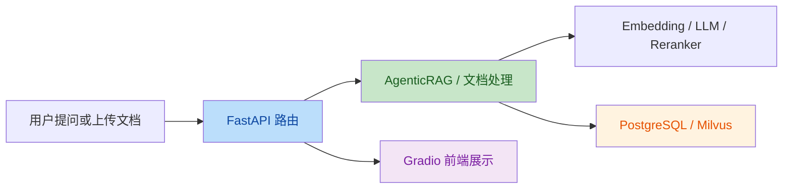

# AgenticRAG 项目代码审查报告

审查日期：2026-06-09

修复状态：本报告记录的是审查时发现的问题与证据；其中表格中的 5 个问题已在本次会话中完成修复并进行了回归验证。

审查范围：`app/` 与 `front/` 下的核心 Python 代码，重点覆盖启动链路、数据库与向量库接入、AgenticRAG 流程、文档上传链路和 Gradio 前端调用。

Intent：该项目的目标是提供一个基于 FastAPI + LangGraph + Milvus + Gradio 的 AgenticRAG 系统，支持查询分析、检索、重排、文档上传与问答界面。

## 变更理解

### 业务流



### 技术风险点

```mermaid
flowchart TD
    S1[启动时 init_db] --> S2{Document 是否注册到同一 Base?}
    S2 -->|否| S3[documents 表不会创建]
    R1[路由聚合] --> R2[documents.router 被挂载两次]
    R2 --> R3[/vectors/* 路径失真]
    D1[文档上传 store_vectors=True] --> D2[调用 embed_query]
    D2 --> D3[运行时进入 warning 分支<br/>向量未落库]
    F1[Gradio 查询分析] --> F2[JSON body 调用 analyze]
    F2 --> F3[后端按 query param 解析<br/>返回 422]
    style S3 fill:#ffcdd2,color:#b71c1c
    style R3 fill:#ffcdd2,color:#b71c1c
    style D3 fill:#ffcdd2,color:#b71c1c
    style F3 fill:#ffcdd2,color:#b71c1c
```

## 发现的问题

| No. | Issue Title | Suggestion | Code Link |
|-----|-------------|------------|-----------|
| 1 | `Document` 模型挂在了独立的 SQLAlchemy `Base` 上，`init_db()` 不会创建 `documents` 表 | 统一使用 `app.database.postgres.Base` 作为所有 ORM 模型的基类，并在启动前确保模型模块被导入到同一份 metadata 中 | [postgres.py:L27-L60](file:///Users/bytedance/Desktop/zkc/python/AgenticRAG/app/database/postgres.py#L27-L60) / [document.py:L8-L13](file:///Users/bytedance/Desktop/zkc/python/AgenticRAG/app/db_models/document.py#L8-L13) |
| 2 | `documents.router` 同时被挂载到 `/documents` 和 `/vectors`，导致文档 CRUD 被重复暴露，真实向量接口变成 `/vectors/vectors/*` | 将向量相关接口拆到独立 router，或只保留一次挂载；确保 OpenAPI 中实际路径与 README、前端调用一致 | [api.py:L11-L14](file:///Users/bytedance/Desktop/zkc/python/AgenticRAG/app/routes/api.py#L11-L14) |
| 3 | 文档上传的向量化分支调用了不存在的 `embedding_manager.embed_query()`，而且没有 `await`，`store_vectors=True` 时向量写入必然失败，只是被 warning 吞掉 | 改为调用异步的 `await embedding_manager.create_embedding(...)`，并在向量写入失败时把错误显式返回给调用方或标记为部分成功 | [documents.py:L153-L178](file:///Users/bytedance/Desktop/zkc/python/AgenticRAG/app/routes/documents.py#L153-L178) / [embedding.py:L33-L65](file:///Users/bytedance/Desktop/zkc/python/AgenticRAG/app/models/embedding.py#L33-L65) |
| 4 | Gradio 查询分析调用把 `query` 放在 JSON body 中，但后端 `analyze_query()` 把它声明为普通函数参数，FastAPI 会按 query string 解析，前端固定得到 `422` | 统一协议：要么把后端改成 `BaseModel` body，要么把前端改成 query param；当前两端定义必须保持一致 | [api_client.py:L91-L102](file:///Users/bytedance/Desktop/zkc/python/AgenticRAG/front/api_client.py#L91-L102) / [agentic_rag.py:L137-L176](file:///Users/bytedance/Desktop/zkc/python/AgenticRAG/app/routes/agentic_rag.py#L137-L176) |
| 5 | 文档列表前端假设后端返回 `{"documents": [...]}`，但后端实际直接返回数组；一旦后端返回成功数据，`result.get(...)` 会在列表对象上抛异常 | 统一响应契约：前端按数组处理，或后端改成对象包装；并补一个最小集成测试覆盖文档列表页面 | [app.py:L142-L150](file:///Users/bytedance/Desktop/zkc/python/AgenticRAG/front/app.py#L142-L150) / [documents.py:L243-L258](file:///Users/bytedance/Desktop/zkc/python/AgenticRAG/app/routes/documents.py#L243-L258) |

## 验证记录

- 运行 `uv run python` 检查 metadata，`documents` 不在 `postgres_manager.Base.metadata.tables` 中，确认问题 1 为确定性缺陷。
- 读取运行中服务的 OpenAPI，实际暴露了 `/api/v1/vectors/vectors/search`、`/api/v1/vectors/upload`、`/api/v1/vectors/{document_id}` 等路径，确认问题 2。
- 调用 `APIClient.agentic_rag_analyze("你好")`，返回 `422 Client Error`，确认问题 4。
- 静态对照 `documents.py` 与 `embedding.py`，`embed_query()` 在工程中不存在，确认问题 3。
- 静态对照 `front/app.py` 与 `documents.py`，前后端文档列表响应结构不一致，确认问题 5。

## 结论

本项目的整体结构清晰，模块边界也基本成型。审查时发现的问题主要集中在 ORM 注册、路由聚合和前后端接口契约上，这些问题已经在本次会话中修复。后续建议在 PostgreSQL 与 Milvus 就绪的环境下补一轮端到端自测，确认文档上传和检索链路都能跑通。
